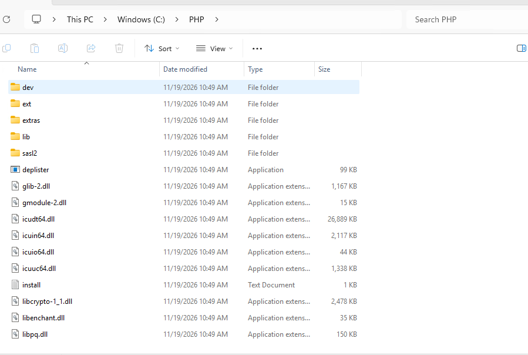
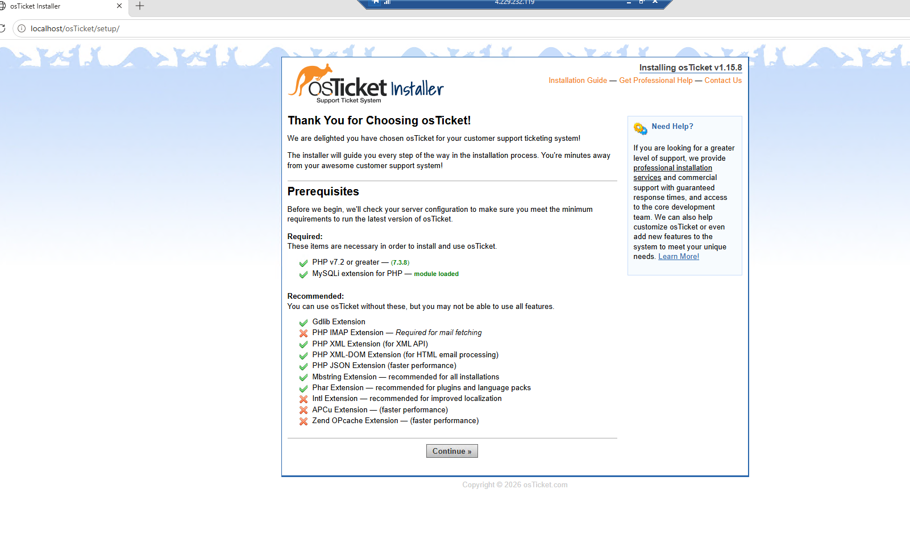
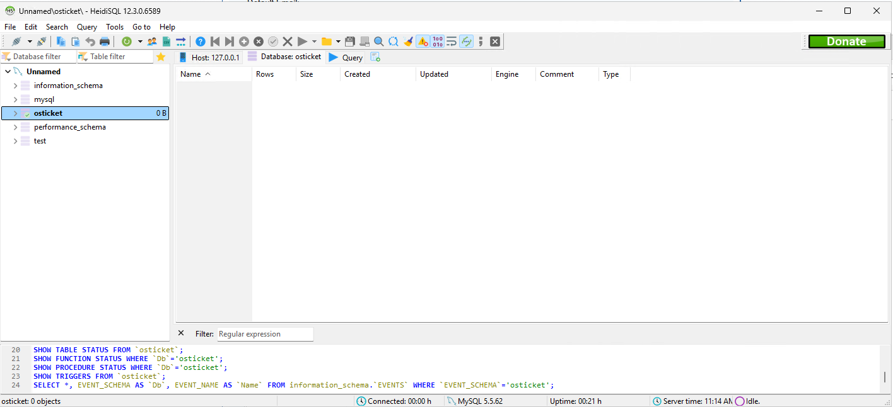

# osticket-prereqs

<h1>osTicket - Pre-Install Configuration</h1>
This tutorial outlines the pre-install configuration of the open-source help desk ticketing system osTicket. 

<h2>Environments and Technologies Used</h2>

- Microsoft Azure (Virtual Machines/Compute)
- Remote Desktop
- Internet Information Services (IIS)

<h2>Operating Systems Used </h2>

- Windows 11</b> (24H2)

<h2>Configuration Steps</h2>

  First step is to Install/Enable IIS with CGI to act as our web server to host the OS Tickets.

Next a few steps:
  Install PHP manager for OS,
  Install Rewrite Module

 

Next create a new Folder in the C drive to house the PHP docs, and then install VC redist if not already installed. You will also need My Sequel as a storage database for OSticket.
 

  now open up IIS and register php inside, restart IIS services once PHP has been registered.

Make sure an osTicket folder exists inside inetpub\wwwroot folder. Once finished head on into the localhost for the osTicket domain 
  
  make sure to go back into IIS to enable php extensions: _imap.dll,_intl.dll, and _opache.dll. Using heidi SQL set up your database
  

 
