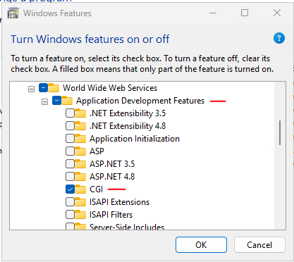
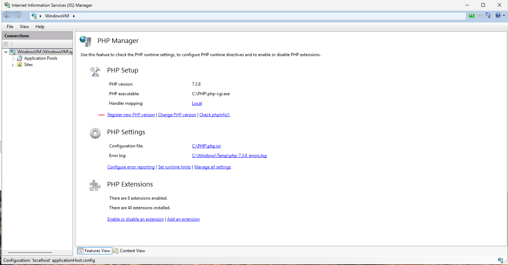

# osticket-prereqs

<h1>osTicket - Pre-Install Configuration</h1>
This tutorial outlines the pre-install configuration of the open-source help desk ticketing system osTicket. 

<h2>Environments and Technologies Used</h2>

- Microsoft Azure (Virtual Machines/Compute)
- Remote Desktop
- Internet Information Services (IIS)

<h2>Operating Systems Used </h2>

- Windows 11</b> (24H2)

<h2>Pre-Install Configuration Objectives</h2>

- Item 1
- Item 2
- Item 3
- Item 4
- Item 5

<h2>Configuration Steps</h2>

  First step is to Install/Enable IIS with CGI to act as our web server to host the OS Tickets.

Next a few steps:
  Install PHP manager for OS,
  Install Rewrite Module

 

Next create a new Folder in the C drive to house the PHP docs, and then install VC redist if not already installed. You will also need My Sequel as a storage database for OSticket.
 

  now open up IIS and register php inside, restart IIS services once PHP has been registered.

Lorem ipsum dolor sit amet, consectetur adipiscing elit, sed do eiusmod tempor incididunt ut labore et dolore magna aliqua. Ut enim ad minim veniam, quis nostrud exercitation ullamco laboris nisi ut aliquip ex ea commodo consequat. Duis aute irure dolor in reprehenderit in voluptate velit esse cillum dolore eu fugiat nulla pariatur.

 
